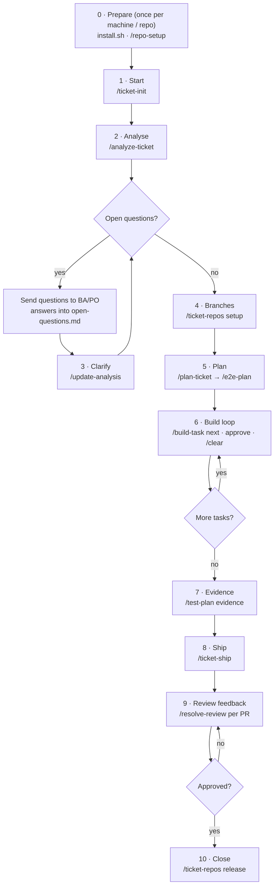

# Execution flow

What to run, where, and in what order, from a new ticket to merged PRs. The rules and reasons behind each step are in [`workflow.md`](workflow.md).



**Session rule:** start each step in a fresh context (`/clear`, or a new `claude`). The files in the ticket folder carry the state, so nothing is lost. `/ticket-status` tells you where you are at any point.

---

## 0. Prepare (once)

| When | Where | Run |
|---|---|---|
| Once per machine | the kit folder | `AWF_REPOS_ROOT=~/path/to/repos ./install.sh`, then restart Claude Code |
| Once per machine | — | Edit the descriptions in `~/.config/ai-dev-workflow/repos.yml` |
| Once per service repo | **inside the repo** (`cd <repo> && claude`) | `/repo-setup` |
| After a new clone | the kit folder | `bin/awf-repos-scan` |
| After pulling kit changes | the kit folder | `git pull && ./install.sh` |

## 1. Start a ticket

```bash
cd ~/work/tickets && claude
```
```
/ticket-init PROJ-123 short-description
```
Give it the ticket (it's fetched if a tracker connector is set up; otherwise paste it or give a file path), then confirm the suggested repos.
**You get:** `~/work/tickets/PROJ-123/` with `ticket.md` (AC1, AC2…) and candidate repos.

From here on, **always start Claude Code in the ticket folder:**
```bash
cd ~/work/tickets/PROJ-123 && claude
```

## 2. Analyse

```
/analyze-ticket
```
**You get:** `analysis.md`, `open-questions.md`, the confirmed repos and their roles, and a paste-ready question list.
**You do:** post the questions to the ticket.

## 3. Clarify (repeat until ready)

Write the BA/PO's answers under **Answer** in `open-questions.md` and set each to `answered`. Then:
```
/clear
/update-analysis
```
Repeat while new questions come up. **Done when** the analysis status is `ready`.

## 4. Create branches

```
/clear
/ticket-repos setup
```
Approve the plan it shows. The ticket branch is created in every repo being changed, and repos that only need to run are put on their latest main.
**You do:** restart or rebuild the Docker services it lists, if any.

## 5. Plan

```
/clear
/plan-ticket
```
Review the proposal in chat, adjust, then approve. **You get:** `plan.md` and `tasks.md`.

If any AC needs e2e coverage:
```
/clear
/e2e-plan "optional coverage notes"
```
Approve the coverage. **You get:** `e2e-plan.md` with TP IDs, plus the e2e tasks in `tasks.md`.

Optional: `/test-plan draft` gives the BA/PO the planned test items to confirm before anything is built.

## 6. Build: one task per session

```
/clear
/build-task next
```
Each run builds **one** task: specs first, then the code, checks, and a review loop (up to 3 rounds). Then it stops and shows a summary. Reply:

| Reply | Effect |
|---|---|
| `approve` | Commit this task's files |
| `approve & push` | Commit, push and open a draft PR/MR if there's none |
| `changes: …` | Adjust, then come back to this summary |

Repeat `/clear` → `/build-task next` until every task is `done`.
**For e2e tasks:** start the local stack first. The command checks it and tells you what's missing.

## 7. Evidence

Start the local stack, then:
```
/clear
/test-plan evidence            # or: /test-plan evidence jira
```
Approve the screenshot method the first time it asks. **You get:** `test-plan.md` and `evidence/<KEY>_TP-NN.png`.
**You do:** post the test plan to the ticket and attach the screenshots against the Evidence column.

## 8. Ship

```
/clear
/ticket-ship check     # optional: the Definition of Done report only
/ticket-ship
```
It checks the Definition of Done, offers a sync if main has moved, then pushes every repo (with your approval) and creates or updates all the PRs/MRs, linked to each other in deploy order. It marks them ready when you say so.
**You do:** share the PR list it gives you with the reviewers.

## 9. Review feedback (per PR, per round)

```
/clear
/resolve-review <PR number or URL>
```
Approve the triage, then the push, then each reply. The PR description is refreshed if the fixes changed it. Repeat for each PR and each review round.

## 10. Close

When everything is merged:
```
/ticket-repos release
```
Your clones switch back to main. The ticket folder stays as the record.

---

## Situations along the way

| Situation | Run |
|---|---|
| "Where am I? What's next?" | `/ticket-status` |
| The BA/PO changes scope mid-build | Add the answer to `open-questions.md`, then `/update-analysis`. It proposes the task changes |
| Another repo turns out to be involved | `/ticket-repos add <repo> [role]` |
| main has moved (multi-day ticket) | `/ticket-repos sync` |
| A session was interrupted mid-task | `/build-task next`. It resumes the task that's `in-progress` or `review` |
| Review a finished task again | `/review-task T#` |
| The review loop hit its cap with must-fix items open | You decide at the summary: fix by hand, change the plan, or override with `AWF_SKIP_REVIEW_GATE=1` for that session |
| An e2e test fails and might be pre-existing | Follow `/build-task`'s triage: re-run the spec with the stack on main |
| Update a single PR description | `/pr-describe <repo> --refresh` |
| Pause the ticket for urgent work | `/ticket-repos release` (clones back to main), then `/ticket-repos setup` to resume |
| A repo's commands changed | `/repo-setup --update` inside that repo |

## Cheat sheet

```
prepare   install.sh · /repo-setup (per repo)
start     /ticket-init KEY
analyse   /analyze-ticket → answers → /update-analysis (repeat)
branches  /ticket-repos setup
plan      /plan-ticket → /e2e-plan
build     /build-task next → approve → /clear   (repeat)
evidence  /test-plan evidence
ship      /ticket-ship
review    /resolve-review PR   (per PR, per round)
close     /ticket-repos release
anytime   /ticket-status
```
